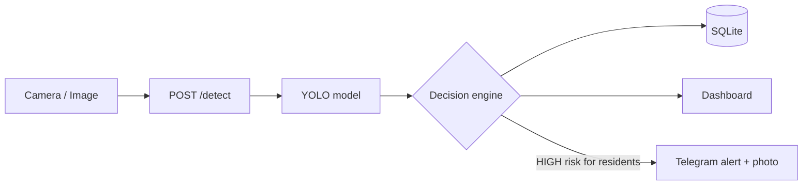

<div align="center">

# 🌿 ForestSentinel

### AI wildlife monitoring that turns camera-trap photos into decisions, not just detections.


</div>

---

## What is this?

Forest-edge villages live alongside tigers, leopards, elephants and bears. A camera that only says *"tiger detected"* isn't enough: a tiger deep in the forest is routine, the same tiger seen three times near a village in six hours is an emergency.

**ForestSentinel** detects animals in camera-trap images with a YOLO model, then runs every sighting through a rule-based **decision engine** that considers the species, the camera's zone, the time of day and the recent sighting history. High-risk events trigger a **Telegram alert with the photo** to nearby residents, and everything lands on a live dashboard for forest officials.

## Screenshots

| Dashboard | Decision engine |
|-----------|-----------------|
|  |  |

| Telegram message editor | Camera map |
|-------------------------|------------|
|  |  |

## Features

- **Animal detection**: YOLO (Ultralytics) model loaded once at startup, annotated evidence photos saved for every sighting.
- **Decision engine**: five transparent, tunable rules produce a risk level, plain-language reasons and a recommended action for each detection (see below).
- **Telegram alerts**: residents get a warning with the evidence photo. Anyone who messages the bot is subscribed automatically, and a cooldown prevents spam.
- **Custom alert text**: write your own alert message in **Settings**, with clickable `{placeholders}` and a live preview.
- **Live dashboard**: latest detections, recent and historical alerts, and a map of all cameras (Leaflet + OpenStreetMap).
- **Identify tool**: upload any photo and see what the model finds. Nothing is saved and no alerts are triggered.
- **AI assistant**: ask questions about your data in plain English (powered by Groq, optional).
- **Camera management**: add, edit and remove cameras and assign each to a zone.
- **Built-in simulator**: start or stop a demo feed from Settings to try the whole system without any real cameras.
- **Secure by default**: JWT login, hashed passwords, protected API.

## How it works



### The decision engine

| # | Rule | Who is told | Triggers when |
|---|------|-------------|---------------|
| 1 | **Human-wildlife conflict** | Residents | A dangerous or conflict-prone species is seen **3+ times in 6 hours** at a camera near people |
| 2 | **Suspicious human activity** | Officials | A person is detected in a restricted forest zone (**HIGH at night, 8 PM to 5 AM**) |
| 3 | **Possible injury / distress** | Officials | *Placeholder.* Hook for an injury model (`assess_injury()`), planned for tiger, leopard and wild boar |
| 4 | **Unusual activity** | Officials | **4+ sightings in 30 minutes** and **5x** the species' own 14-day normal |
| 5 | **Zone-based risk** | Residents | The same animal is *routine* deep in the forest but a *concern* at the village edge |

The highest-rated finding wins. Residents are alerted by Telegram only for **HIGH** resident-facing decisions, at most once per species and camera every 30 minutes.

**Species tiers:** high = tiger, leopard, elephant, bear; moderate = hyena, wolf, bison, wild boar; everything else = low.
**Zones:** `deep_buffer`, `near_farmland`, `village_edge`.

All thresholds are plain constants at the top of the decision-engine section in `app.py`, so you can tune them for your own region.

## Quick start

### 1. Clone

```bash
git clone https://github.com/AnushGhodmare/forestsentinel-final-year-project.git
cd forestsentinel-final-year-project
```

### 2. Backend

```bash
python -m venv .venv
source .venv/bin/activate          # Windows: .venv\Scripts\activate
pip install -r requirements.txt
```

Copy `.env.example` to `.env` and fill in whatever you want to enable (both keys are optional, see [Configuration](#configuration)).

Put your trained YOLO weights in the project root as **`best.pt`**, then start the server:

```bash
uvicorn app:app --reload
```

The API is now at <http://127.0.0.1:8000> and interactive docs are at <http://127.0.0.1:8000/docs>.

> On a machine without an NVIDIA GPU you can save several GB by installing CPU-only PyTorch first:
> `pip install torch torchvision --index-url https://download.pytorch.org/whl/cpu`

### 3. Frontend

```bash
cd frontend
npm install
npm run dev
```

Open the URL that Vite prints (usually <http://localhost:5173>). The frontend talks to the API at `http://127.0.0.1:8000`. If you host the backend elsewhere, change `API_URL` at the top of `frontend/src/App.jsx`.

### 4. Log in

On first run the backend creates an admin account:

| Username | Password |
|----------|----------|
| `admin`  | `admin123` |

⚠️ **Change this (and `SECRET_KEY` in `app.py`) before exposing the app to anyone.**

### 5. Try it without cameras

Create folders `images/<camera name>/` containing a few `.jpg` / `.png` photos, where the folder name matches a camera name. Then open **Settings** and start the **auto-simulator**. It feeds random photos through the full pipeline every 15 to 20 seconds (adjustable).

## Configuration

Create a `.env` file in the project root (see `.env.example`):

| Variable | Required | Purpose |
|----------|----------|---------|
| `TELEGRAM_BOT_TOKEN` | For alerts | Token from [@BotFather](https://t.me/BotFather) |
| `TELEGRAM_CHAT_ID` | No | A group or channel to alert in addition to individual subscribers |
| `TELEGRAM_PROXY` | No | e.g. `http://127.0.0.1:7890` if Telegram is blocked on your network |
| `GROQ_API_KEY` | For AI assistant | Free key from [console.groq.com](https://console.groq.com). Extra keys: `GROQ_API_KEY_2` to `_6`, or a comma-separated `GROQ_API_KEYS` |

### Setting up Telegram alerts

1. Message [@BotFather](https://t.me/BotFather), send `/newbot`, and copy the token into `.env`.
2. Restart the backend. The console confirms Telegram is configured.
3. Anyone who sends a message to your bot is subscribed to alerts automatically.
4. In **Settings → Telegram Alert Message**, customise the text. Available fields:

   `{species}` `{location}` `{zone}` `{date}` `{time}` `{note}` `{title}` `{action}`

   Lines whose fields come out empty (for example `{note}` when there is nothing to add) are skipped automatically.

## Project structure

```
├── app.py               # FastAPI backend: API, auth, YOLO, decision engine, Telegram, simulator
├── requirements.txt     # Python dependencies (pinned)
├── .env.example         # Template for your secrets
├── best.pt              # YOLO weights (you provide)
├── images/              # Sample photos for the simulator, one folder per camera
├── evidence/            # Annotated detection photos (created automatically)
├── wildlife.db          # SQLite database (created automatically)
└── frontend/
    └── src/App.jsx      # React dashboard
```

## API at a glance

Full interactive docs live at `/docs` when the server is running.

| Area | Endpoints |
|------|-----------|
| Auth | `POST /login` |
| Cameras | `GET/POST /cameras`, `PUT/DELETE /cameras/{id}` |
| Detection | `POST /detect`, `POST /identify` |
| Data | `GET /detections`, `/alerts`, `/decisions` |
| Telegram | `GET/PUT /settings/telegram`, `POST /settings/telegram/preview`, `GET /telegram/subscribers` |
| Assistant | `POST /assistant/ask` |
| Simulator | `POST /simulate/start`, `/stop`, `/config`, `GET /simulate/status` |

## Roadmap

- [ ] Train and plug in the injury / distress model (rule 3)
- [ ] Per-user and per-zone Telegram subscriptions
- [ ] Docker setup for one-command deployment
- [ ] Export alert history as CSV / PDF reports

## Contributing

Issues and pull requests are welcome. If you tune the decision-engine thresholds for another region or add a new rule, please describe your reasoning in the PR.

## License

Add a license of your choice (for example MIT) as a `LICENSE` file and name it here.

---

<div align="center">
Built to help people and wildlife share the same forest edge. 🐯
</div>
